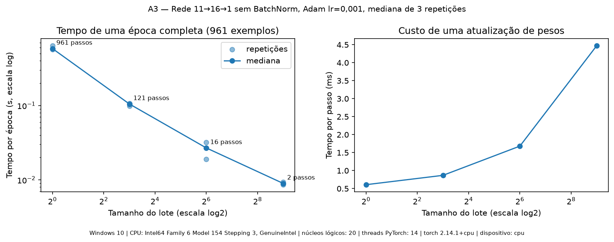
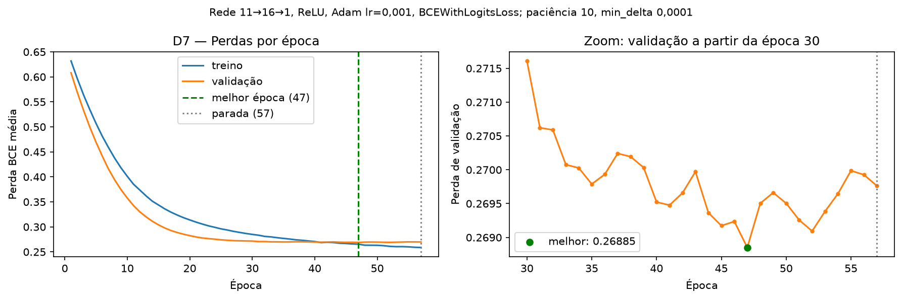
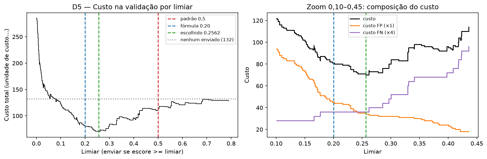
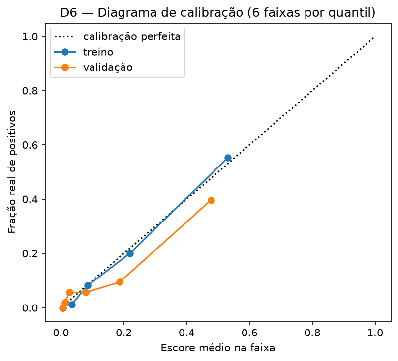
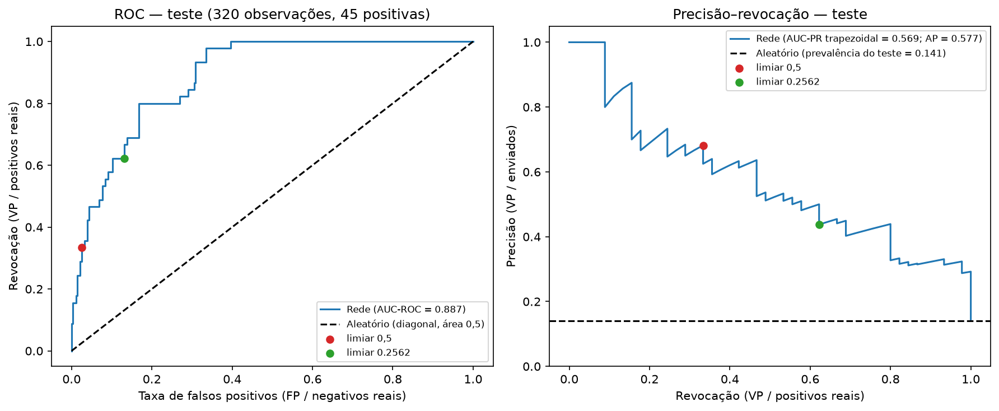

# Lab 2 — Relatório individual

Nome: Phelipe Calado de Souza Costa
Turma: Dados 4o Período (2026.2)
Link do repositório: https://github.com/phelipecscosta/deep-learning-cesar/tree/main/lab-02

Substitua os marcadores pelas suas medições e análises. Consulte ENUNCIADO.pdf para os requisitos integrais.

## Reprodução
**Ambiente:** Python 3.11.4; numpy 2.4.6, pandas 3.0.6, scikit-learn 1.9.1, matplotlib 3.11.2, torch 2.14.1+cpu; Windows 11 64 bits; CPU Intel de 12ª geração (família 6, modelo 154), 20 núcleos lógicos, 14 threads no PyTorch; sem GPU (dispositivo cpu); VS Code com extensão Jupyter. Sementes: 42 (partição B2, Dataset/DataLoader, D7 e sementes de referência), 2026 (partição interna da Parte C) e as cinco sementes da Parte C (42, 7, 123, 2024, 31415).

**Execução:** na pasta lab-02, criar o ambiente (python -m venv .venv), ativá-lo (.venv\Scripts\Activate.ps1 no Windows), instalar as dependências (python -m pip install -r requirements.txt), abrir lab02.ipynb com o kernel da .venv e executar Restart Kernel e Run All. As tabelas, figuras, o modelo e a configuração congelada são gravados em resultados/.

**Modificações em apoio.py:** não houve. O SHA-256 do arquivo confere com o registrado em MANIFESTO.json (f6af5d69…6a78).

## Base e definição do alvo
**Fonte:** Red Wine Quality (Cortez et al., 2009), UCI Machine Learning Repository, licença CC BY 4.0; arquivo dados/winequality-red.csv sem alteração (SHA-256 conferido por carregar_base). **Unidade de observação:** uma amostra de vinho tinto (Vinho Verde português), com 11 medidas físico-químicas e uma nota sensorial (quality, mediana de pelo menos três avaliações de especialistas, escala 0–10). **Características:** apenas as 11 colunas de FEATURES; quality, alvo, id_linha e grupo_perfil não entram no modelo. **Alvo:** alvo = 1 se quality >= 7, senão 0; convenção do laboratório, não regra universal de qualidade. Base inteira: 1599 linhas, 217 positivas (13,57%), 0 ausentes, 1359 perfis distintos e 240 ocorrências repetidas de perfis.

**Limitações:** perfis idênticos não provam que duas linhas são o mesmo vinho físico (não há identificador de entidade); não há datas, produtores, regiões, castas ou preços; só há vinhos tintos de uma denominação de origem; a nota é sensorial e subjetiva; os custos usados na decisão são hipotéticos.

## B1 — Cinco cenários
1. Avaliações de produtos: média de cerca de 16,7 avaliações por usuário (provavelmente desigual, com poucos usuários muito ativos). Hipótese de uso: classificar avaliações de usuários novos. Partição por grupo, com cada usuário inteiro em um único conjunto (por exemplo, GroupShuffleSplit pelo identificador do usuário). Numa divisão aleatória, estilo de escrita, vocabulário e tendência a ser generoso ou crítico do mesmo usuário apareceriam no treino e no teste, e o modelo seria avaliado reconhecendo pessoas, não avaliações; o resultado ficaria otimista e a queda só apareceria em produção. Se o uso fosse com usuários já conhecidos, aproveitar o histórico deles não seria vazamento, e uma divisão aleatória ou temporal por usuário seria defensável.
2. Turbinas: hipótese de uso: monitorar as mesmas 20 turbinas no futuro. Partição temporal (treino com o período inicial, validação e teste com períodos posteriores), com intervalo de 24 h entre os conjuntos, pois o rótulo das últimas leituras do treino depende de falhas ocorridas no período seguinte. Numa divisão aleatória, leituras vizinhas de minuto quase idênticas e as cerca de 1440 leituras que antecedem a mesma falha (todas com rótulo 1) ficariam dos dois lados, e o modelo seria avaliado reconhecendo eventos já vistos. Leituras após a parada da turbina devem ser removidas ou tratadas. Se o uso fosse em turbinas novas, seria necessário também separar turbinas inteiras (por grupo e no tempo); com apenas 20 turbinas, essa estimativa seria instável.
3. Spam: cerca de 6.000 spams (3%). Hipótese: e-mails independentes, coletados no mesmo período em que o filtro será usado, sem campanhas massivas repetidas; o enunciado não informa datas nem campanhas. Sob essa hipótese, uma divisão aleatória estratificada pela classe é defensável, pois garante cerca de 3% de spam em cada conjunto. Riscos se a hipótese falhar: cópias quase idênticas da mesma campanha nos dois lados fariam o modelo ser avaliado reconhecendo campanhas, e e-mails da mesma época não revelariam a perda de desempenho com táticas novas (deriva de conceito). Mitigação: agrupar quase duplicatas (por exemplo, hash do texto normalizado) e, se houver datas, avaliar no período mais recente.
4. Radiografias: cerca de 8,9 imagens por paciente. Hipótese de uso: analisar radiografias de pacientes novos. Partição por paciente, com todas as imagens de cada paciente em um único conjunto (de preferência estratificada por grupo, para manter a proporção de achados). Numa divisão aleatória, anatomia, marca-passo, próteses, cicatrizes e achados crônicos do mesmo paciente apareceriam no treino e no teste; o modelo poderia acertar reconhecendo o paciente ou atalhos (por exemplo, marca-passo associado a doença cardíaca), e não o achado. O enunciado não informa hospital ou aparelho; se houver mais de uma origem, há risco de o modelo reconhecer a origem da imagem em vez do achado, e só uma avaliação com origens inteiras fora do treino revelaria isso.
5. Transações, tempo e clientes: o uso é avaliar transações futuras, e as táticas de fraude mudam com o tempo; partição temporal em todos os conjuntos (por exemplo, treino 2019–2023, validação 2024, teste 2025–2026), com intervalo de maturação entre eles, pois fraudes são confirmadas semanas depois e transações recentes ainda aparecem com rótulo 0 indevido. Características devem ser calculadas apenas com dados anteriores a cada transação; um agregado anual incluiria contestações futuras, inclusive a da própria transação. Identidade: se o sistema atende clientes conhecidos, usar o histórico anterior deles é legítimo e a partição temporal basta; se deve atender clientes novos, o teste precisa conter clientes inteiros ausentes do treino (temporal + por cliente), com métricas separadas para conhecidos e novos. Numa divisão aleatória, rajadas de fraude do mesmo cartão clonado ficariam nos dois lados, e o modelo seria avaliado reconhecendo o ataque.

## B2 — Auditoria da separação
**Pergunta de uso:** dado o perfil físico-químico de uma amostra de vinho tinto (11 medidas), o modelo identifica amostras de alta nota (`quality >= 7`) que ainda não foram avaliadas sensorialmente? Para estimar isso sem otimismo, o modelo não deve ser avaliado em perfis que já apareceram no treino.

**Estratégia:** partição por grupos com `GroupShuffleSplit` (semente 42, declarada antes da divisão), usando `grupo_perfil` (hash das 11 características) como grupo, sem usar o alvo. Primeiro, 20% dos grupos foram reservados para o teste; em seguida, 25% dos grupos restantes formaram a validação (0,25 × 0,80 ≈ 20% do total). As proporções se referem a grupos; as contagens de linhas variam levemente.

| Conjunto | Linhas | Positivos | Proporção positiva | Perfis |
|---|---:|---:|---:|---:|
| Treino | 961 | 139 | 0,1446 | 815 |
| Validação | 318 | 33 | 0,1038 | 272 |
| Teste | 320 | 45 | 0,1406 | 272 |

**Verificações:** soma das linhas = 1599 (igual à base); 1599 `id_linha` únicos; cobertura completa; soma dos perfis por conjunto = 1359 (igual aos perfis distintos da base); linhas em comum e perfis em comum entre cada par de conjuntos = 0; ambas as classes presentes nos três conjuntos. Tabela exportada em `resultados/b2_auditoria.csv`.

**Observação sobre as classes:** a validação ficou com proporção positiva menor (10,4%, 33 positivos). A semente não foi alterada para corrigir isso, pois escolher a partição pelo resultado seria uma forma de ajuste indevido. Consequência: as decisões tomadas na validação (época de parada e limiar) têm maior incerteza, especialmente nas métricas que dependem dos positivos.

**Limitações:** perfis idênticos não provam que duas linhas são o mesmo vinho físico, pois a base não tem identificador de entidade. A base não contém datas, produtores nem regiões, portanto esta partição não permite avaliar desempenho em períodos futuros, novos produtores ou outros domínios (por exemplo, vinhos brancos ou de outras denominações de origem).

## A1 — Dataset
Classe `MeuDataset(torch.utils.data.Dataset)`, que recebe uma partição, a lista das 11 características e, opcionalmente, média e desvio. Sem estatísticas informadas (treino), aprende média e desvio apenas com suas linhas; validação e teste recebem e reutilizam os valores do treino. Convenção do desvio: populacional (`ddof=0`, divisão por n). Desvios menores que 1e-12 são substituídos por 1, e a coluna resultante vale 0. A classe recusa colunas de alvo/identificadores como entrada e gera erro se a normalização produzir NaN/infinito.

**Verificações:** comprimentos 961 / 318 / 320. Um exemplo: X `(11,)` `float32`, y `()` `float32`; um lote de 8: X `(8, 11)`, y `(8,)`. Nenhum NaN/infinito e rótulos apenas 0/1 nos três conjuntos. Média e desvio da validação e do teste são idênticos aos do treino, e a média própria da validação é diferente da do treino, o que mostra que não houve recálculo. Após normalizar, o treino tem média 0 e desvio 1 em todas as colunas; validação e teste têm médias próximas, mas diferentes de zero (entre -0,08 e +0,13), o que é esperado ao aplicar a régua do treino a outra amostra. A linha 0 da validação conferiu com o cálculo manual `(x - média_treino) / desvio_treino`, e o rótulo correspondente também. Um teste artificial com `pH` constante detectou a coluna com desvio zero sem gerar valores inválidos. Estatísticas do treino exportadas em `resultados/a1_estatisticas_treino.csv`.

## A2 — DataLoader

| Conjunto | batch_size | shuffle | drop_last | num_workers | Justificativas |
|---|---|---|---|---|---|
| Treino | 64 | True (gerador com semente 42) | True | 0 | Lote 64: 15 atualizações por época, compromisso entre ruído do gradiente e estabilidade; o tempo por lote é medido na A3. Shuffle: a ordem do arquivo não deve influenciar o aprendizado, e a semente torna o sorteio reprodutível. Drop_last: 961 = 15 × 64 + 1; sem descarte, cada época teria uma atualização baseada em uma única observação. Com o embaralhamento, a observação descartada muda a cada época, então nenhuma fica permanentemente de fora. Workers 0: dados já em memória como tensores; processos auxiliares adicionariam custo sem benefício e costumam travar em notebooks no Windows. |
| Validação | 256 | False | False | 0 | Sem gradientes, o tamanho do lote só afeta velocidade, não o resultado (2 lotes). Sem shuffle: rótulos e escores ficam alinhados e na ordem do Dataset (verificado). Drop_last False: as 318 observações são avaliadas (resto 62 incluído). Workers 0: mesmo motivo do treino. |
| Teste | 256 | False | False | 0 | Mesmas razões da validação: as 320 observações são avaliadas (resto 64 incluído), em ordem fixa e alinhada aos rótulos. |

## A3 — Tempo por época
| Lote | Repetição 1 (s) | Repetição 2 (s) | Repetição 3 (s) | Mediana (s) | Passos |
|---|---|---|---|---|---|
| 1 | 0,5845 | 0,5710 | 0,6418 | 0,5845 | 961 |
| 8 | 0,1071 | 0,1050 | 0,0980 | 0,1050 | 121 |
| 64 | 0,0191 | 0,0269 | 0,0320 | 0,0269 | 16 |
| 512 | 0,0086 | 0,0094 | 0,0090 | 0,0090 | 2 |

**Método:** rede 11 → 16 → 1 sem BatchNorm, Adam (lr = 0,001), BCEWithLogitsLoss, 961 exemplos de treino, drop_last=False, num_workers=0, shuffle com gerador de semente 42. Cada medição restaura o mesmo estado inicial dos pesos e cria um otimizador novo. Para cada lote, uma época de aquecimento fora da medição e três repetições cronometradas com time.perf_counter em torno de treinar_epoca (época completa: previsão, perda, retropropagação e atualização). CPU, sem sincronização (necessária apenas em GPU). Equipamento: Windows 11, Intel 12ª geração (família 6, modelo 154), 20 núcleos lógicos, 14 threads no PyTorch, torch 2.14.1+cpu. Os valores acima são da execução final do notebook (reiniciado e executado do início); tabelas em resultados/a3_tempos_repeticoes.csv e resultados/a3_tempos_resumo.csv.

**Análise:** o tempo por época caiu monotonicamente, de 0,58 s (lote 1) para 0,009 s (lote 512), cerca de 65 vezes. O tempo por passo subiu bem menos que o tamanho do lote: 0,61 ms, 0,87 ms, 1,68 ms e 4,48 ms; de 1 para 512 exemplos por passo, o custo de cada passo cresceu só cerca de 7 vezes. Com lotes pequenos, predomina o custo fixo de cada passo (chamadas Python, zerar gradientes, passo do otimizador); com lotes maiores, esse custo se dilui e a CPU processa os exemplos de forma vetorizada. O ganho relativo a cada aumento de 8 vezes no lote diminuiu (5,6×, 3,9× e 3,0×), e o ganho absoluto encolheu (−0,48 s, −0,08 s e −0,02 s): a partir do lote 64, a época já leva centésimos de segundo e resta pouco a economizar, embora o tempo não tenha parado de cair. A variação entre repetições foi maior no lote 64 (0,019 a 0,032 s), e uma execução anterior, com o computador mais ocupado, produziu tempos absolutos maiores (por exemplo, 0,78 s no lote 1) com a mesma tendência; por isso, a mediana é usada e os valores absolutos devem ser lidos como dependentes da carga da máquina. Lotes diferentes também produzem quantidades diferentes de atualizações: com lote 512, uma época tem só 2 atualizações de pesos, contra 961 com lote 1. Uma época mais rápida não significa aprender mais rápido; esta medição compara custo computacional por época, não tempo até atingir uma perda.

## A4 — BatchNorm
**Condição do erro:** subconjunto de 65 observações sorteadas apenas do treino (semente 42), lote 64; 65 % 64 = 1, confirmado numericamente. Lotes produzidos com drop_last=False: [64, 1]. Rede criar_modelo(11, batchnorm=True) em modo train(), via treinar_epoca.

**Mensagem capturada (ValueError):** Expected more than 1 value per channel when training, got input size torch.Size([1, 16]). O erro ocorre porque, em modo de treino, o BatchNorm1d calcula média e variância de cada um dos 16 canais da camada oculta usando o próprio lote; com um único exemplo, a variância não é estimável. A captura é específica: apenas ValueError com essa mensagem; qualquer outro erro é relançado.

**Correção:** restauração do estado inicial dos pesos (o primeiro lote de 64 já havia atualizado o modelo antes da falha), otimizador novo e DataLoader com drop_last=True e shuffle=True (gerador com semente 42). Lotes produzidos: [64]; a época rodou em modo train() com perda de treino 0,6502.

**Consequência e custo:** uma observação é descartada por época (64 de 65 usadas); com o embaralhamento, a descartada muda a cada época, então nenhuma fica permanentemente fora do treino. A normalização do BatchNorm não foi alterada. Alternativa considerada: escolher um lote que não deixe resto 1 (por exemplo, 33), sem descarte, mas frágil, pois o problema retorna se o tamanho da base mudar. Colocar a rede em eval() durante o treino não foi usado, pois mudaria o comportamento do BatchNorm e não corrige o procedimento. O treino principal tem a mesma condição (961 = 15 × 64 + 1); o drop_last=True do loader_treino (A2) já previne esse erro caso se use BatchNorm.

## C — Duas formas de vazamento
| Forma | Dados e partições internas | Métrica | Incorreto | Corrigido | Diferença/unidade |
|---|---|---|---|---|---|
| 1 — pré-processamento aprendido com dados reservados | Wine Quality real; c_desenvolvimento = treino + validação da B2 (1279 linhas), dividido por perfil (GroupShuffleSplit, semente 2026) em c_treino (959; 12,8% positivos) e c_avaliacao (320; 15,3% positivos) | AUC-ROC em c_avaliacao, média de 5 sementes fixadas antes (42, 7, 123, 2024, 31415); secundária: perda log | 0,8435 | 0,8438 | −0,029 pp de AUC (faixa −0,128 a +0,083; desvio-padrão entre sementes do corrigido: 0,684 pp) |
| 2 — alvo ou derivado entre as características | Wine Quality real; mesmas partições internas da forma 1 (c_treino 959, c_avaliacao 320); incorreto com 12 entradas: as 11 características mais nota_sensorial, cópia renomeada de quality; corrigido com as 11 características | AUC-ROC em c_avaliacao, média das mesmas 5 sementes; secundária: perda log | 0,9957 | 0,8438 | +15,19 pp de AUC (faixa +13,75 a +16,55; positiva nas 5 sementes); perda log 0,084 contra 0,321 |

**Experimento 1 — forma 1 (pré-processamento com dados reservados).** Informação protegida: a distribuição das características em c_avaliacao. Ponto de travessia: o cálculo de média e desvio da padronização, antes do treino. Versão incorreta: estatísticas calculadas com c_treino + c_avaliacao e aplicadas aos dois. Versão corrigida: estatísticas aprendidas só com c_treino e repassadas a c_avaliacao. Protocolo fixado antes da comparação: rede 11 → 16 → 1, Adam lr = 0,001, lote 64, 50 épocas fixas (sem parada antecipada, para não usar c_avaliacao em escolhas), mesmas sementes nas duas versões (mesmos pesos iniciais e embaralhamento). Uma semente própria (2026) foi usada na divisão interna porque, com a semente 42, o GroupShuffleSplit reproduzia exatamente o treino e a validação da B2; a troca foi feita antes de calcular qualquer métrica. Resultado: a contaminação deslocou as médias em no máximo 0,027 desvio e os desvios em no máximo 4,4%; a AUC média foi 0,8435 (incorreto) contra 0,8438 (corrigido), diferença de −0,029 pp, com sinais mistos (incorreto superior em 2 de 5 sementes) e efeito cerca de 24 vezes menor que a variação entre sementes (0,684 pp). Interpretação: nesta base e com este modelo, o efeito não é distinguível do ruído, porque a avaliação interna vem da mesma distribuição do treino, a padronização não usa o rótulo e um deslocamento afim pequeno é absorvido pela primeira camada. O procedimento continua incorreto, pois simula acesso a dados que não existiriam no momento do ajuste; o efeito tende a crescer com treinos pequenos, avaliação de distribuição diferente ou pré-processamentos que usam o rótulo. Detalhes por semente em resultados/c_forma1_sementes.csv.

**Experimento 2 — forma 2 (alvo entre as características).** Informação protegida: a nota sensorial quality, da qual o alvo é derivado (alvo = quality >= 7). Ponto de travessia: a montagem da matriz de entradas, antes do treino. Transformação declarada: na versão incorreta, foi criada a coluna nota_sensorial, cópia exata de quality, adicionada como 12ª entrada; a normalização continuou aprendida só com c_treino, para isolar este mecanismo. A proteção do MeuDataset, que recusa a coluna quality pelo nome, não detectou a cópia renomeada, o que mostra que verificações por nome não substituem conhecer a origem de cada coluna. A regra nota_sensorial >= 7 reproduz o alvo em 100% das linhas de c_avaliacao. Versão corrigida: apenas as 11 características (mesmos datasets e resultados do corrigido da forma 1, conferido numericamente). Mesmo protocolo e sementes da forma 1. Resultado: AUC média 0,9957 (incorreto) contra 0,8438 (corrigido), diferença de +15,19 pp, positiva em todas as sementes e cerca de 22 vezes maior que a variação entre sementes; perda log 0,084 contra 0,321. A AUC não chega a 1 porque a rede precisa aprender o corte na nota em 50 épocas, mas a avaliação fica totalmente inflada. Contraste com a forma 1: a gravidade depende de quanta informação sobre o alvo atravessa a fronteira; a forma 1 vazou só a distribuição das entradas (efeito no nível do ruído), a forma 2 vazou o próprio rótulo (efeito grande e consistente). Detalhes por semente em resultados/c_forma2_sementes.csv.

**Como preservei o teste principal:** a Parte C usou apenas as linhas de treino + validação da B2 (c_desenvolvimento, 1279 linhas), com verificação por assert de que nenhum id_linha do teste principal estava presente. As partições internas usaram uma semente própria (2026) e todas as variáveis da Parte C têm prefixo c_ ou c1_/c2_, sem sobrescrever dados, estatísticas ou modelos da Parte D. Nenhuma decisão da Parte D foi tomada com os resultados da Parte C, e a rede principal da D7 é criada do zero.

## D7 — Treinamento e parada
**Configuração (definida antes do treino):** rede nova 11 → 16 → 1 com ReLU (criar_modelo de apoio, sem BatchNorm), Adam com lr = 0,001, BCEWithLogitsLoss sem ponderação de classes, loader_treino (lote 64, shuffle com semente 42, drop_last=True), máximo de 100 épocas, paciência 10, melhora mínima 0,0001 na perda de validação. O loader de teste não é parâmetro da função de treino, e a perda de teste não é calculada no laço.

**Procedimento:** a cada época, treino com treinar_epoca, perda de validação com avaliar_perda (sem gradientes) e comparação com a melhor perda menos a melhora mínima. Ao melhorar, cópia independente dos pesos com copy.deepcopy(modelo.state_dict()), além da época e da perda; caso contrário, o contador de épocas sem melhora é incrementado. Ao atingir a paciência, o laço para e os melhores pesos são restaurados.

**Resultado:** a parada ocorreu por paciência (o máximo de épocas não foi atingido). Melhor época: 47, com perda de validação 0,26885; época final: 57 (dez épocas seguidas sem melhora). Confirmação da restauração: a perda de validação do modelo após a restauração é 0,26885, igual à melhor registrada e diferente da última época (0,26976), verificada por assert.

**Análise:** após a época 47, a perda de treino continuou caindo (0,265 → 0,259) enquanto a de validação estagnou em torno de 0,269–0,270, indicando início de sobreajuste (platô, sem subida acentuada). Até cerca da época 40, a perda de validação ficou abaixo da de treino porque a validação tem menor proporção de positivos (10,4% contra 14,5%; a perda de um preditor constante na prevalência seria cerca de 0,333 contra 0,413) e porque a perda de treino é a média durante a época, com pesos ainda em atualização. Limitação: de 30 a 47 épocas a validação melhorou só cerca de 0,003, com oscilações de cerca de 0,0005 entre épocas; a escolha exata da época tem componente de ruído, coerente com uma validação de 318 linhas e 33 positivos. Histórico completo em resultados/d7_historico.csv.

## D4 — Matriz de custos
**Ação:** o modelo é um filtro de triagem. Previsão positiva significa enviar a amostra para uma análise especial (painel de especialistas que confirma a qualidade antes de destinar o vinho a uma linha superior); previsão negativa significa não enviar, e a amostra segue o fluxo comum. O modelo não aprova nem rejeita vinhos; quem confirma a qualidade é o painel.

**Unidade:** unidade de custo relativa, em que 1 = custo de uma análise especial (tempo de especialistas, vaga de análise, insumos). Foi escolhida em vez de valores monetários para não sugerir preços reais.

| Resultado | Situação | Custo |
|---|---|---|
| Verdadeiro negativo | nota < 7 não enviada | 0 |
| Falso positivo | nota < 7 enviada à análise especial | C_FP = 1 |
| Falso negativo | nota >= 7 não enviada | C_FN = 4 |
| Verdadeiro positivo | nota >= 7 enviada | 0 |

**Justificativa da relação (C_FN = 4 × C_FP):** o falso positivo é detectado pelo próprio painel, que funciona como última barreira; a perda se limita a uma análise. O falso negativo não tem correção posterior: o vinho de alta nota segue como comum, o produtor perde a diferença de valor e a reputação associadas à linha superior, e ninguém fica sabendo do erro. Supõe-se que essa perda equivale a cerca de quatro análises especiais.

**Hipóteses e origem dos custos:** todos os valores são hipóteses deste exercício; a base Wine Quality não contém preços, perdas ou custos operacionais. Acertos têm custo zero por simplificação, e os custos de erro são supostos constantes por amostra. Custo de uma regra de decisão: C_FP × nº de FP + C_FN × nº de FN. Limiar teórico de referência C_FP / (C_FP + C_FN) = 0,20, usado apenas para comparação na D6; o limiar adotado será buscado na validação (D5).

## D5 e D6 — Escolha na validação
**Escores:** obtidos com obter_escores(modelo_final, loader_validacao) após a restauração da melhor época; 318 observações, 33 positivas, escores de 0,0016 a 0,7885, 272 escores únicos (igual ao número de perfis da validação, pois perfis idênticos recebem o mesmo escore).

**Candidatos e desempate:** todos os 272 escores únicos, mais os extremos 0 (todas enviadas) e acima do máximo (nenhuma enviada); sem grade, portanto sem aproximação. Regra: enviar se escore >= limiar. Critério: menor custo total (C_FP × FP + C_FN × FN). Desempate declarado antes: maior limiar entre os de custo mínimo (menos envios com o mesmo custo). Houve um único limiar de custo mínimo.

| Regra (validação) | Limiar | VN | FP | FN | VP | Enviados | Custo total | Custo/observação |
|---|---|---|---|---|---|---|---|---|
| Nenhum enviado | acima do máximo | 285 | 0 | 33 | 0 | 0 | 132 | 0,415 |
| Todos enviados | 0 | 0 | 285 | 0 | 33 | 318 | 285 | 0,896 |
| Padrão | 0,5 | 271 | 14 | 25 | 8 | 22 | 114 | 0,358 |
| Fórmula | 0,20 | 241 | 44 | 9 | 24 | 68 | 80 | 0,252 |
| Escolhido na validação | 0,2562 | 251 | 34 | 9 | 24 | 58 | 70 | 0,220 |

**Comparação com 0,5:** o limiar escolhido reduziu o custo de 114 para 70 (−44 unidades, −39%; 0,358 → 0,220 por observação), trocando 20 FP adicionais por 16 FN a menos. Com 0,5, apenas 8 dos 33 positivos seriam enviados, e o custo ficaria próximo de não enviar nada (132).

**Robustez:** apenas 10 limiares (de 0,2297 a 0,2857) ficam a até 10% do custo mínimo. O escolhido está na borda direita desse vale, exatamente sobre o escore de um positivo: um limiar ligeiramente maior perderia esse positivo (+4). A posição do corte está ajustada a esta amostra, o que é uma limitação para a generalização. A mesma validação orientou a parada (D7) e o limiar, então seus custos são evidência de desenvolvimento e tendem a ser otimistas, não uma estimativa independente.

**D6 — Fórmula:** C_FP / (C_FP + C_FN) = 1/5 = 0,20. Na validação, a fórmula encontrou os mesmos 24 positivos que o limiar escolhido, mas com 10 FP a mais (custo 80 contra 70), pois entre 0,20 e 0,2562 só há negativos. A fórmula pressupõe escores iguais às probabilidades reais da população, custos constantes e custo zero para acertos.

**Investigação (calibração):** no treino, os escores estão bem calibrados (escore médio 0,148 contra prevalência 0,145; faixas próximas da diagonal). Na validação, superestimam (escore médio 0,131 contra 0,104; faixa de escore cerca de 0,19 com 9% de positivos; cerca de 0,48 com 40%). Brier score: 0,0814 no treino e 0,0805 na validação, contra 0,1237 e 0,0947 da referência constante (prevalência do treino), ou seja, melhora de cerca de 34% e 15%. Perto de 0,2, os escores da validação superestimam a chance real, o que explica o ótimo empírico acima da fórmula. Contribuem também o tamanho pequeno da amostra (33 positivos; custo em degraus) e a diferença de prevalência entre treino e validação; a busca não usou grade, e a perda não foi ponderada. Os dados não permitem separar descalibração do modelo de variação amostral da validação; a sigmoide não garante probabilidade calibrada.

**Configuração congelada antes do teste:** modelo restaurado da época 47 (pesos em resultados/modelo_final_state_dict.pt, com impressão SHA-256 dos pesos registrada), as 11 entradas, média e desvio do treino principal (ddof=0), C_FP = 1 e C_FN = 4, regra "enviar se escore >= limiar", limiar escolhido 0,2562 e limiar padrão 0,5 para relato. Tudo registrado em resultados/configuracao_congelada.json. O limiar da fórmula fica apenas como referência.

## D1 e D2 — Avaliação final
**Procedimento:** antes de abrir o teste, a impressão SHA-256 dos pesos foi recalculada e conferida com a configuração congelada (assert). Os escores do teste foram obtidos uma única vez com o modelo restaurado; avaliaram-se apenas as duas regras já fixadas (0,5 e 0,2562). Nenhuma escolha foi feita a partir do teste; o limiar da fórmula (0,20) não foi avaliado no teste para não criar uma terceira opção.

**Proporção positiva e convenções:** teste com 320 observações, 45 positivas (prevalência 0,1406). Classe majoritária identificada no treino: 0. Matrizes com linhas = real e colunas = previsto, na ordem [0, 1]. Quando não há previsões positivas, precisão e F1 = 0 (zero_division=0). AUCs calculadas com escores, não com classes. O baseline trivial tem escore constante, não ordena observações; suas AUCs não são reportadas.

**Matriz — rede, limiar 0,5:**

| | previsto 0 | previsto 1 |
|---|---|---|
| real 0 | 268 | 7 |
| real 1 | 30 | 15 |

**Matriz — rede, limiar escolhido na validação (0,2562):**

| | previsto 0 | previsto 1 |
|---|---|---|
| real 0 | 239 | 36 |
| real 1 | 17 | 28 |

| Regra | Limiar | Acurácia | Precisão | Revocação | F1 | AUC-ROC | AUC-PR (trapezoidal) | AP | Custo/observação |
|---|---|---|---|---|---|---|---|---|---|
| Trivial do treino (sempre 0) | não se aplica | 0,859 | 0,000 | 0,000 | 0,000 | não reportada | não reportada | não reportada | 0,563 (180) |
| Rede: padrão | 0,5 | 0,884 | 0,682 | 0,333 | 0,448 | 0,887 | 0,569 | 0,577 | 0,397 (127) |
| Rede: escolhido na validação | 0,2562 | 0,834 | 0,438 | 0,622 | 0,514 | 0,887 | 0,569 | 0,577 | 0,325 (104) |

Custos em unidades de custo hipotéticas (C_FP = 1, C_FN = 4); entre parênteses, o custo total.

**Análise:** o classificador trivial atinge acurácia 0,859 sem encontrar nenhum vinho de alta nota, o que reflete a prevalência de 14% e mostra que a acurácia sozinha é pouco informativa aqui. A rede com 0,5 supera o trivial em só 2,5 pp de acurácia e encontra 15 dos 45 positivos. O limiar escolhido tem acurácia menor que o trivial (0,834), mas encontra 28 dos 45 positivos (revocação 0,622, quase o dobro de 0,5) e tem o menor custo: 104, contra 127 com 0,5 (−18%) e 180 com o trivial (−42%); a troca é de 29 FP a mais por 13 FN a menos. As AUCs são iguais nas duas linhas da rede porque o limiar muda as classes, não o ordenamento. AUC-PR trapezoidal e AP são cerca de 4 vezes a prevalência. Comparado à validação, o custo por observação do limiar escolhido subiu de 0,220 para 0,325 e a revocação caiu de 0,727 para 0,622, o que é coerente com o uso da validação para parada e limiar e com a maior prevalência do teste (14,1% contra 10,4%, mais oportunidades de FN). A vantagem sobre 0,5 se manteve, porém menor (−39% na validação, −18% no teste). Com 45 positivos, a revocação tem erro-padrão aproximado de 0,07; os valores são estimativas com incerteza considerável. Tabelas em resultados/d2_tabela_final_teste.csv e resultados/d2_matriz_*.csv.

## D3 — Curvas

ROC com a diagonal aleatória de (0,0) a (1,1), área 0,5; PR com a linha horizontal da prevalência do teste (0,141). Os pontos marcam a operação das duas regras fixadas: 0,5 (taxa de FP cerca de 0,03; revocação 0,33; precisão 0,68) e 0,2562 (taxa de FP cerca de 0,13; revocação 0,62; precisão 0,44). Recuperar todos os positivos exigiria aceitar cerca de 40% de falsos positivos. O serrilhado da curva PR reflete o pequeno número de positivos. O ponto inicial (revocação 0, precisão 1) é uma convenção de precision_recall_curve, incluída na área trapezoidal, o que contribui para a diferença em relação à AP.

## D8 — Recomendação
Recomendo usar o modelo apenas como apoio de triagem para decidir quais amostras de vinho tinto enviar à análise especial do painel de especialistas, que continua sendo quem confirma a qualidade. A regra fixada é enviar as amostras com escore igual ou superior a 0,2562, limiar escolhido no conjunto de validação antes de qualquer contato com o teste. No conjunto de teste (320 amostras, 45 de alta nota), essa regra encontrou 28 dos 45 vinhos de alta nota (cerca de 6 em cada 10), enviou 64 amostras ao painel (20% do total), das quais 28 eram de fato de alta nota (cerca de 4 em cada 10 envios), e teve custo de 0,325 por amostra, contra 0,397 com o corte padrão de 0,5 (−18%) e 0,563 sem usar o modelo (−42%). Esses custos são hipotéticos (um vinho bom não enviado equivale a quatro análises especiais; um envio desnecessário, a uma análise) e não vêm de dados reais; se os custos reais forem diferentes, o limiar precisa ser reavaliado. O erro que merece mais atenção são os 17 vinhos de alta nota não enviados (38% dos bons), que seguem como comuns sem que ninguém perceba; reduzi-los exigiria enviar muito mais amostras comuns ao painel. Os resultados têm incerteza considerável: o teste tem apenas 45 vinhos de alta nota (a taxa de 6 em cada 10 pode variar cerca de 14 pontos percentuais para mais ou para menos), o limiar foi escolhido numa validação com só 33 vinhos de alta nota e ficou numa região sensível, e os escores não devem ser lidos como probabilidades. A avaliação vale apenas para amostras semelhantes às desta base (Vinho Verde tinto português, sem datas, produtores ou regiões identificados); não há evidência sobre o desempenho em outros produtores, regiões, safras ou tipos de vinho. Antes de uso real, recomenda-se acompanhar os resultados do painel, medir os custos reais e revalidar o modelo e o limiar com dados novos.

## Referências e limites
**Referências**
- Cortez, P., Cerdeira, A., Almeida, F., Matos, T., & Reis, J. (2009). Wine Quality [Dataset]. UCI Machine Learning Repository. https://doi.org/10.24432/C56S3T
- Cortez, P., Cerdeira, A., Almeida, F., Matos, T., & Reis, J. (2009). Modeling wine preferences by data mining from physicochemical properties. Decision Support Systems, 47(4), 547–553. https://doi.org/10.1016/j.dss.2009.05.016
- Zech, J. R. et al. (2018). Variable generalization performance of a deep learning model to detect pneumonia in chest radiographs: A cross-sectional study. PLOS Medicine, 15(11), e1002683.
- PyTorch — Dataset e DataLoader: https://docs.pytorch.org/docs/stable/data.html
- PyTorch — BCEWithLogitsLoss: https://docs.pytorch.org/docs/stable/generated/torch.nn.BCEWithLogitsLoss.html
- scikit-learn — GroupShuffleSplit: https://scikit-learn.org/stable/modules/generated/sklearn.model_selection.GroupShuffleSplit.html
- scikit-learn — Métricas de avaliação: https://scikit-learn.org/stable/modules/model_evaluation.html
- scikit-learn — Ajuste do limiar de decisão: https://scikit-learn.org/stable/modules/classification_threshold.html
- scikit-learn — Armadilhas comuns e vazamento: https://scikit-learn.org/stable/common_pitfalls.html

**Limites e o que não foi avaliado**
- Desempenho em outros produtores, regiões, safras, períodos ou tipos de vinho: não avaliado (a base não tem esses metadados).
- Incerteza: teste com 45 positivos e validação com 33; métricas e limiar têm variação amostral considerável; nenhum intervalo de confiança formal foi calculado.
- Limiar escolhido na borda de um vale estreito de custo na validação, portanto sensível à amostra.
- Calibração: escores calibrados no treino e superestimados na validação; não foi aplicada recalibração.
- Custos hipotéticos e constantes; custos reais podem mudar o limiar ótimo.
- A validação foi usada para parada antecipada e para o limiar; só o teste fornece a estimativa independente.
- Parte C: efeitos medidos com uma rede pequena e 50 épocas fixas numa partição interna; podem diferir com outros modelos ou bases.
